# AgentForge 设计 QA 证据（2026-11-16）

> 本文档以**真实浏览器**（Microsoft Edge，在线 live 模式）对当前 UI 截图与断言为准，不复用旧结论。
> 红线：不伪造验收。所有截图来自当前版本页面，所有断言实机运行；旧版（2026-11-03）截图已作废，不得引用。
> 服务：`http://127.0.0.1:8000`（live，qwen/deepseek/mimo 三 Provider 可用）。后端测试基线 **179 项通过**。

---

## 一、界面截图（当前版本）

### 1.1 任务工作台首页
入口 `/workbench`：任务输入、计划预览、确认执行、左侧「🔁 自愈演示」按钮。

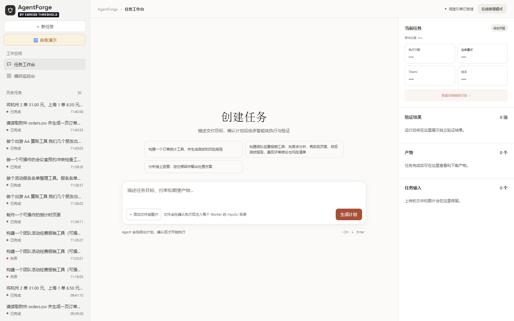

### 1.2 编排监控台 · 复杂任务多 Agent DAG（竞赛主证据）
Run `20261116-112627-f43a61e1`：4 节点 4 角色（需求分析→编码实现→测试验证→交付评审），依赖边标注交接产物（analysis.md / index.html / test_report.md），编码与测试节点显示「自愈重试 ×1」。

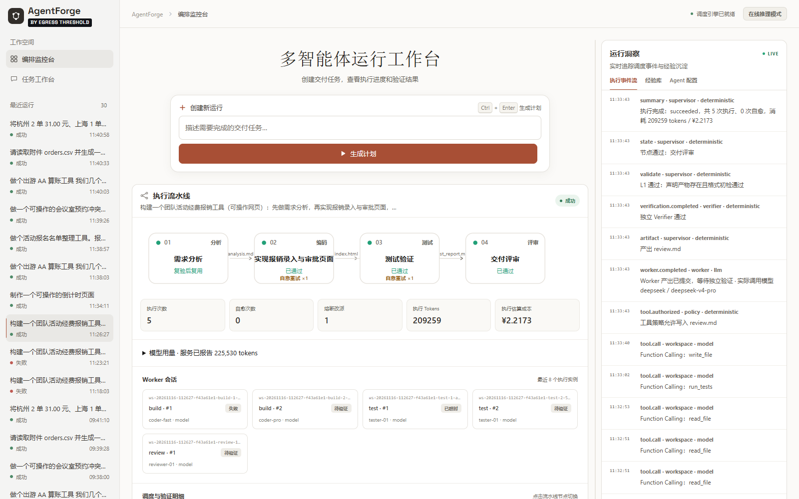

DOM 实测：SVG `#dag` 含 4 个 `g[role=button]` 节点，aria-label 分别为「需求分析，分析，复验后复用」「实现报销录入与审批页面，编码，已通过」「测试验证，测试，已通过」「交付评审，评审，已通过」；viewBox `0 0 732 116`（4 列）；边标签含 analysis.md / index.html / test_report.md。

### 1.3 编排监控台 · 自愈 Run 事件与验证证据
Run `20261116-113735-2c8e4efa`：事件流、验证证据、Worker Session、成本。

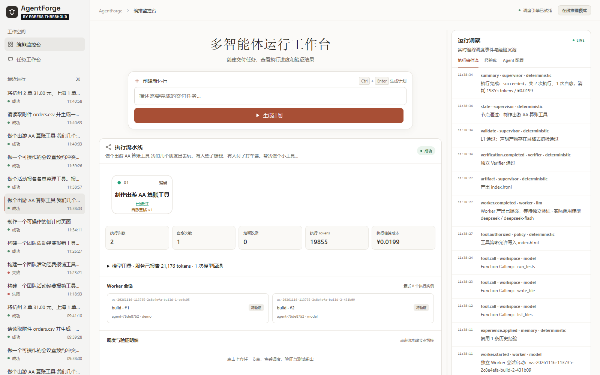

### 1.4 Agent 配置 · 调度排序（选择理由可见）
监控台「Agent 配置」页签：按角色查看调度排序，分数 + 因子理由（能力×0.40 + 成功率×0.25 + 负载×0.20 + 成本×0.15 − 降级罚分）+ 降级/熔断标记 + 预计选中。

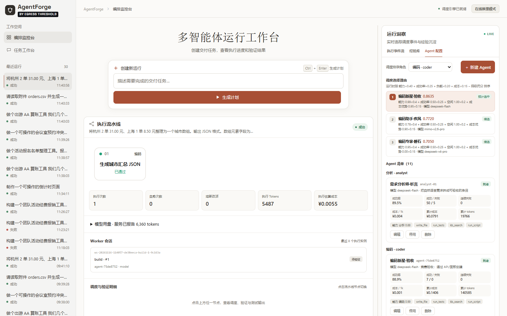

### 1.5 Agent 配置 · Agent 卡片统计
成功率 / 成功失败 / 连续失败 / 成本 / 累计成本 / 累计 tokens / 技能 / 工具。

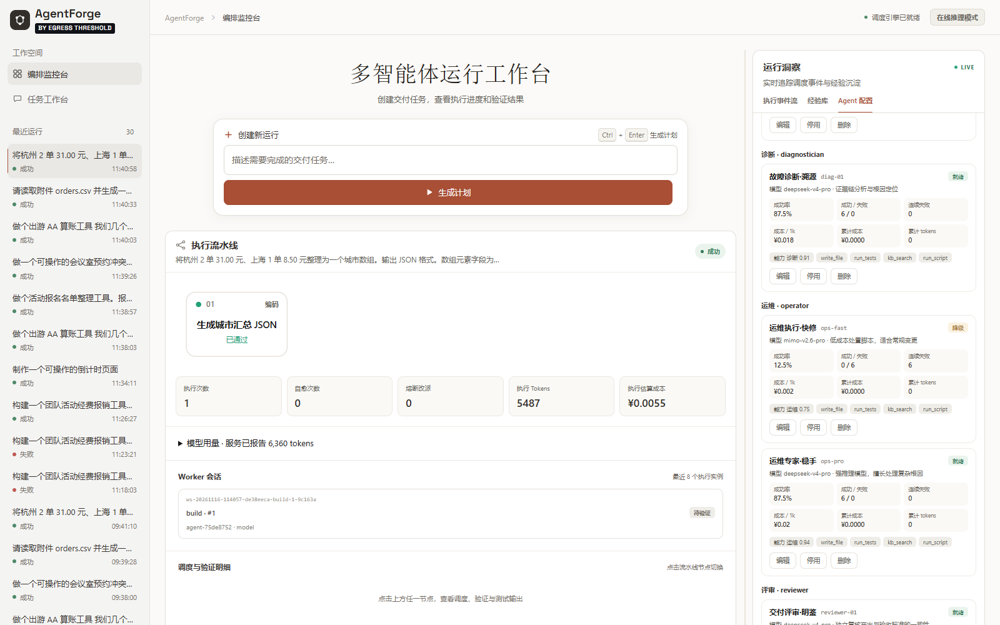

### 1.6 Agent 配置 · 创建/编辑表单
模型候选 datalist、工具复选、能力/成本字段；表单自适应宽度（auto-fit），按钮不截断。

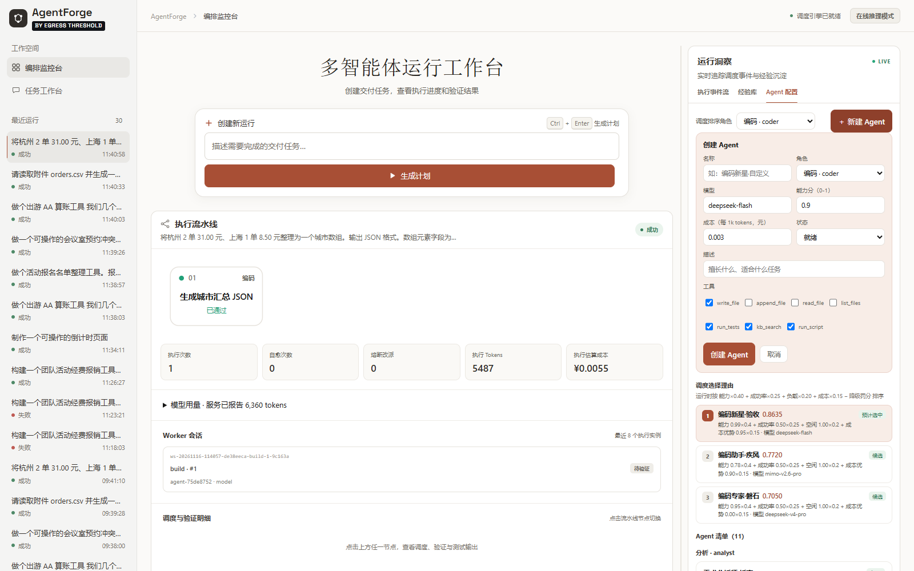

### 1.7 任务工作台 · 自愈叙事卡片
Run `20261116-113735-2c8e4efa`：四步叙事（①平台核算拒绝+证据 ②失败归因+策略 ③携带证据修复+指令节选 ④验收通过+平台用例计数）。

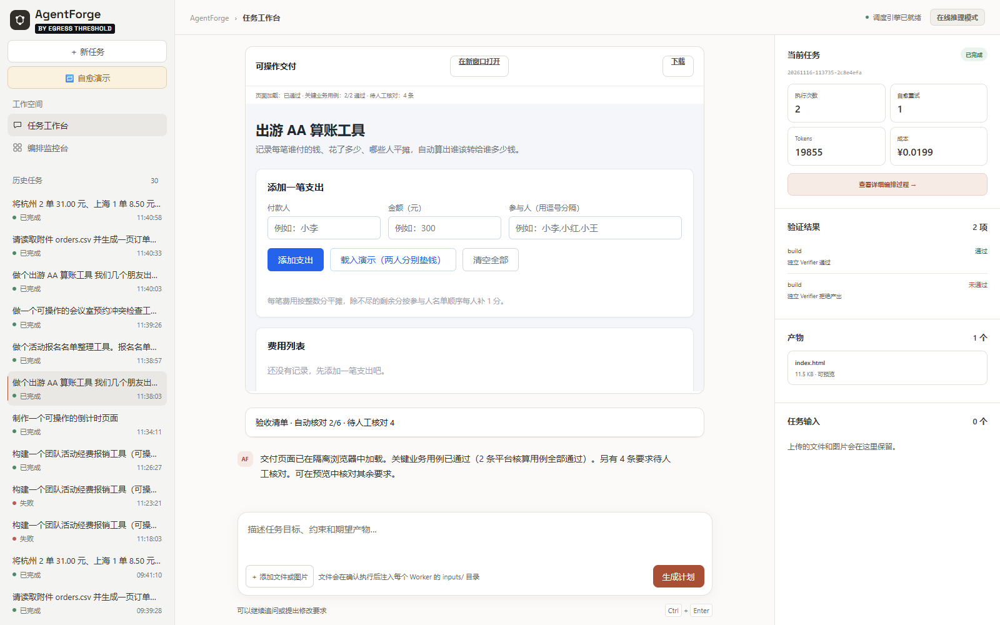

---

## 二、自愈主线 · 失败态/终态双入口截图

来自 `demo_selfheal.py --shots`（Run `20261116-113735-2c8e4efa`，真实执行）：

| 阶段 | 监控台 | 工作台 |
| --- | --- | --- |
| 核算拒绝（失败态） | 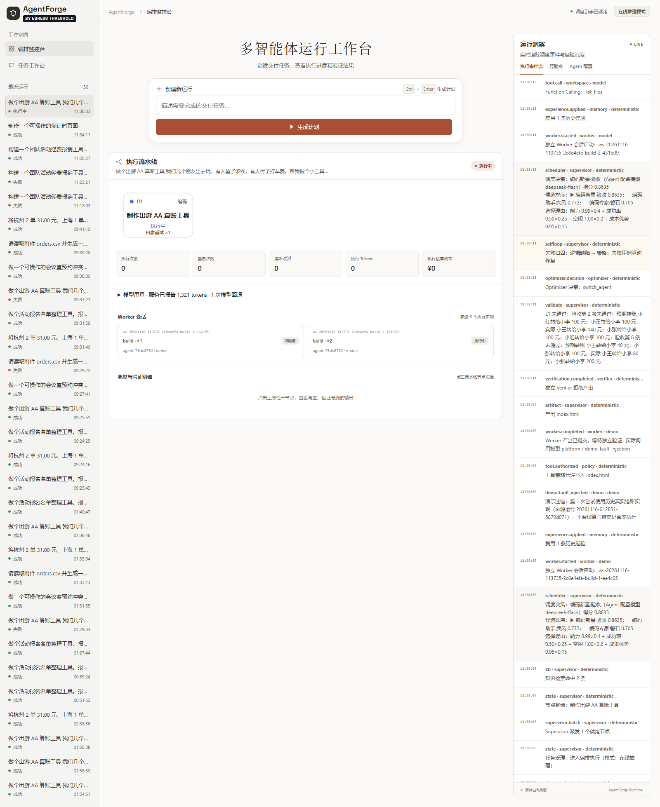 | 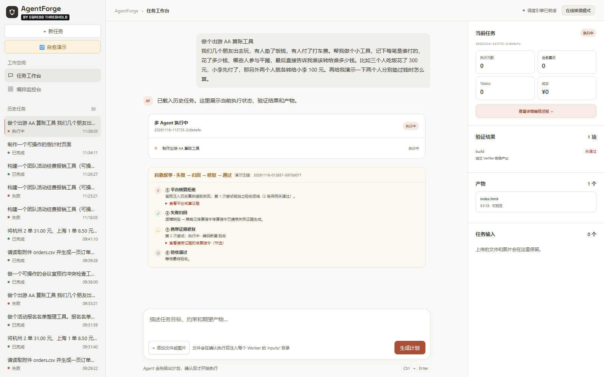 |
| 修复通过（终态） | 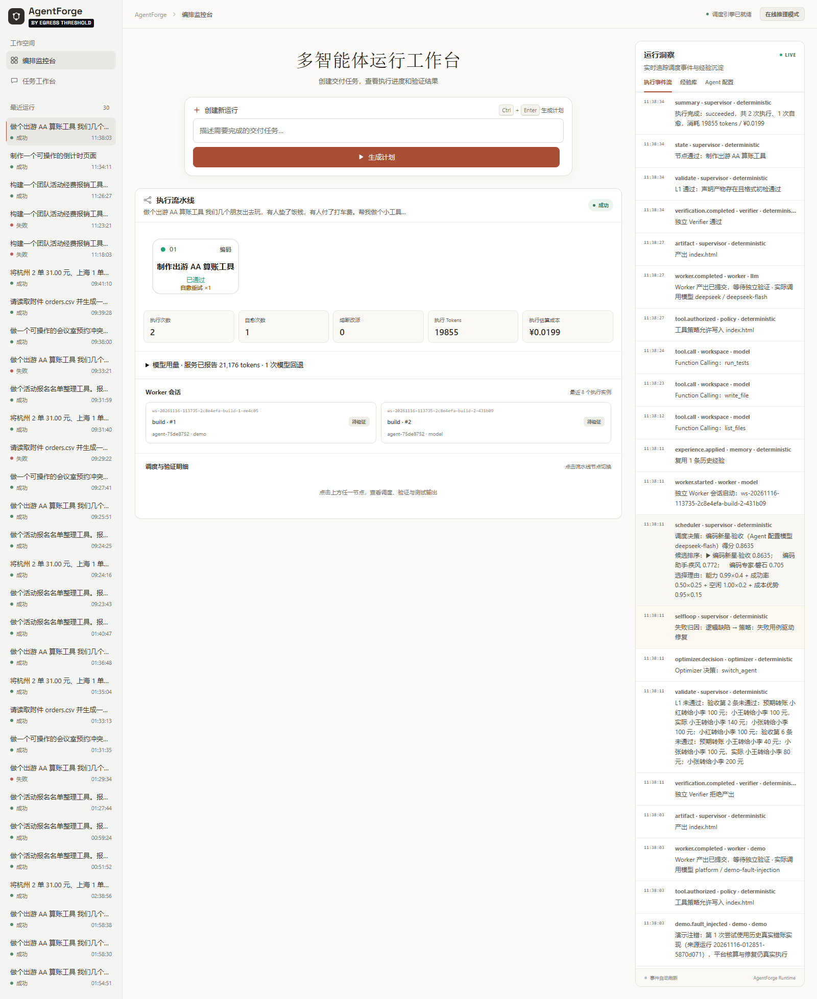 | 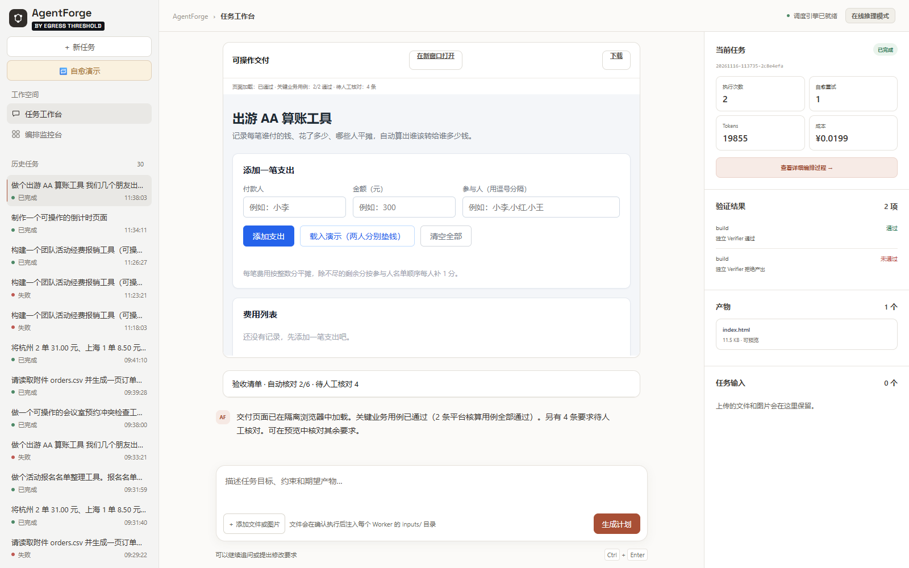 |

证据报告 `output/demo-selfheal-20261116-113735.json`：`injected=true`、`rejected=true`、`attribution=LOGIC_DEFECT`、`repair_attempt=2`、`passed=true`、`grounded_passed=2/2`、`narrative_complete=true`。失败用例：用例 2 实际 140/200、用例 6 实际 80/200 错账（平台独立核算拦下）。

---

## 三、真实浏览器断言结果

以下断言均以真实浏览器自动化驱动 Edge 对 live 服务实机运行：

| 套件 | 结果 | 覆盖 |
| --- | --- | --- |
| 主题一致性 | **16/16** | 新增 UI 全部沿用暖色主题令牌，无新风格 |
| 多节点 DAG 渲染 | **8/8** | 按 deps 分层、交接产物边标注、角色与自愈重试次数 |
| 自愈叙事卡片 | **10/10** | 四步叙事完整、证据展开、指令节选 |
| Agent 面板 UI 全流程 | **6/6** | 表单创建→排序第一→编辑保存→停用移出排序→删除 |
| 右侧分栏拖拽 | **13/13** | 拖拽改宽、表单列数自适应、刷新持久化、双击复位、无横向溢出 |
| 面板拥挤度 | **11/11** | 默认 372px、字段宽≥130、标签/工具栏/卡片无溢出、最小 300px 无溢出 |
| 下拉框稳定性 | **11/11** | 轮询不重建面板、展开期间节点不销毁、选择后不回弹、标题/说明不重叠 |
| 复杂 DAG DOM 复核 | **通过** | 4 节点 4 角色 + 3 交接产物 + 自愈重试 ×1（见 1.2） |
| 后端单元测试 | **179/179** | `python -m unittest discover -s tests` |

截图过程控制台 **无 JS 错误**（`pageerror` 监听为空）。

---

## 四、证据 Run 索引

| 能力 | Run | 状态 |
| --- | --- | --- |
| 多 Agent 协作（4 节点 4 角色） | `20261116-112627-f43a61e1` | succeeded |
| Agent 配置（创建→选中→统计） | `20261116-113346-b183c6a6` | succeeded |
| 自愈主线（注错→拒绝→归因→修复→通过） | `20261116-113735-2c8e4efa` | succeeded |
| 平台盲测（deepseek 5/5） | `output/eval-blind-20261116-114104.md` | 5/5 passed |

---

## 五、复现方式

```bash
# 后端测试
cd backend && python -m unittest discover -s tests        # 179 项

# 自愈主线（含失败态/终态双入口截图与证据报告）
cd backend && python demo_selfheal.py --port 8000 --resume --shots

# 平台盲测
cd backend && python eval_blind.py
```

> 截图目录：`output/design-qa-shots-20261116/`（本次新拍 7 张）、`output/demo-selfheal-shots-20261116-113735/`（自愈 4 张）。